# Tutorial: Front end Android de Guali Tutor (Kotlin)

**Autor:** Pablo Alejandro Pivaral Lobos – Carné 3190-24-11233  
**Curso:** Programación 2 – Universidad Mariano Gálvez, Centro Universitario San José Pinula  
**Catedrático:** Ing. MGSI. César Hernández

## Índice

1. [Introducción](#1-introducción)
2. [Prerrequisitos y software necesario](#2-prerrequisitos-y-software-necesario)
3. [Instalación de Android Studio](#3-instalación-de-android-studio)
4. [Crear el emulador (dispositivo virtual)](#4-crear-el-emulador-dispositivo-virtual)
5. [Crear el proyecto](#5-crear-el-proyecto)
6. [Textos, colores y tema](#6-textos-colores-y-tema)
7. [Barra de menú](#7-barra-de-menú)
8. [Pantalla principal (layout)](#8-pantalla-principal-layout)
9. [Código Kotlin de la pantalla](#9-código-kotlin-de-la-pantalla)
10. [Ejecutar la aplicación](#10-ejecutar-la-aplicación)
11. [Problemas comunes](#11-problemas-comunes)
12. [Estructura final del proyecto](#12-estructura-final-del-proyecto)

## 1. Introducción

Este tutorial explica, paso a paso, cómo crear el front end de una aplicación móvil Android que tiene los elementos de la **Interfaz Principal** de Guali Tutor:

| Elemento | Dónde se construye |
| --- | --- |
| Barra de menú (Lección, Configuración, Base de Datos, Historial, Ayuda) | Paso 7 |
| Título de lección activa | Paso 8.2 |
| Panel de lección activa | Paso 8.3 |
| Editor de código | Paso 8.4 |
| Botones Compilar y Ejecutar | Paso 8.5 |
| Panel de consola | Paso 8.6 |

La aplicación se hace con **Kotlin** y con pantallas en **XML**. Esta versión es **solo el front end** (la parte visual): se ven todos los elementos, pero los botones y las opciones del menú todavía **no ejecutan ninguna acción**. La compilación y la ejecución de código Java, y la conexión con la API, se dejan para una etapa posterior.

Los textos del tutorial están escritos para que cada paso se pueda seguir sin conocimientos avanzados de Android.

## 2. Prerrequisitos y software necesario

**Conocimientos:** tener bases de programación (variables, funciones y clases). No se necesita experiencia previa en Android.

**Computadora (requisitos recomendados por Android Studio, pueden cambiar según la versión):**

| Recurso | Recomendado |
| --- | --- |
| Sistema operativo | Windows 10/11 de 64 bits (también hay versiones para macOS y Linux) |
| Memoria RAM | 8 GB como mínimo; 16 GB para que el emulador funcione con fluidez |
| Espacio en disco | 10 GB libres o más |
| Pantalla | 1280 x 800 o mayor |
| Internet | Necesario para descargar Android Studio, el SDK y las dependencias del proyecto |

**Software:**

| Software | Para qué se usa | Dónde obtenerlo |
| --- | --- | --- |
| Android Studio (versión estable más reciente) | Editor y herramientas para crear apps Android | https://developer.android.com/studio |
| Android SDK (se instala desde Android Studio) | Librerías para compilar la app | Se descarga dentro de Android Studio |
| Emulador de Android (o un celular con depuración USB) | Probar la aplicación | Se crea dentro de Android Studio |
| Git y una cuenta de GitHub (opcional) | Publicar este tutorial | https://git-scm.com y https://github.com |

No hace falta instalar un JDK por separado: Android Studio trae el suyo incluido.

## 3. Instalación de Android Studio

1. Abra https://developer.android.com/studio en el navegador y presione el botón de descarga. Acepte los términos y espere a que termine la descarga.

> **Captura 01:** Página de descarga de Android Studio.

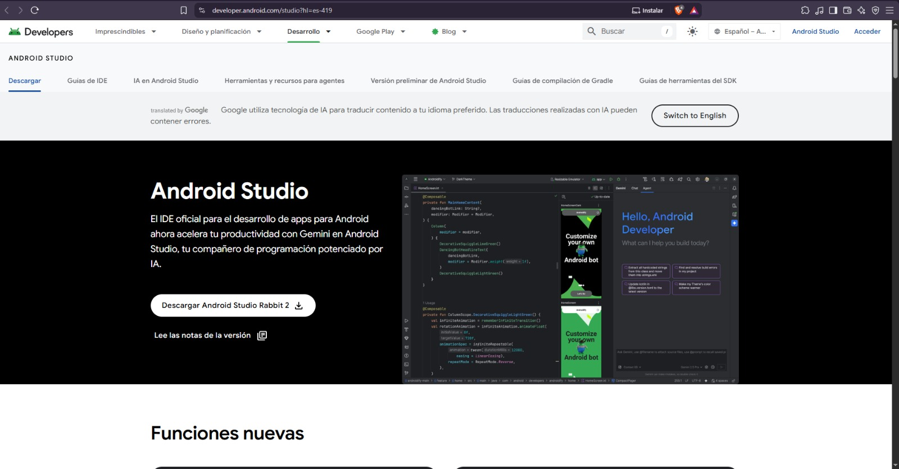

2. Ejecute el instalador descargado (en Windows, un archivo `.exe`). Presione **Next** en cada pantalla y deje marcados los componentes **Android Studio** y **Android Virtual Device**. Presione **Install** y luego **Finish**.

3. Al abrir Android Studio por primera vez, puede aparecer un asistente de configuración. Elija la instalación **Standard**, seleccione el tema que prefiera y acepte las licencias. Android Studio descargará el SDK; este proceso puede tardar varios minutos.
4. Al terminar, se muestra la pantalla de bienvenida con el botón **New Project**.

### 3.1 Verificar el Android SDK

El SDK son las librerías que Android Studio necesita para compilar la aplicación. Si el asistente se omitió, o si más adelante aparece el error `SDK location not found`, se configura así:

1. Abra **File > Settings > Languages & Frameworks > Android SDK**.
2. Revise que el campo **Android SDK Location** tenga una ruta (por ejemplo `C:\Users\SuUsuario\AppData\Local\Android\Sdk`). Si está vacío, presione **Edit** y siga el asistente.
3. En la pestaña **SDK Platforms**, marque **Android 15.0 (API 35)** y presione **Apply** para instalarlo. Acepte la licencia y espere a que termine.

> **Captura 02:** Ventana Android SDK con la ruta del SDK y la plataforma API 35 instalada.

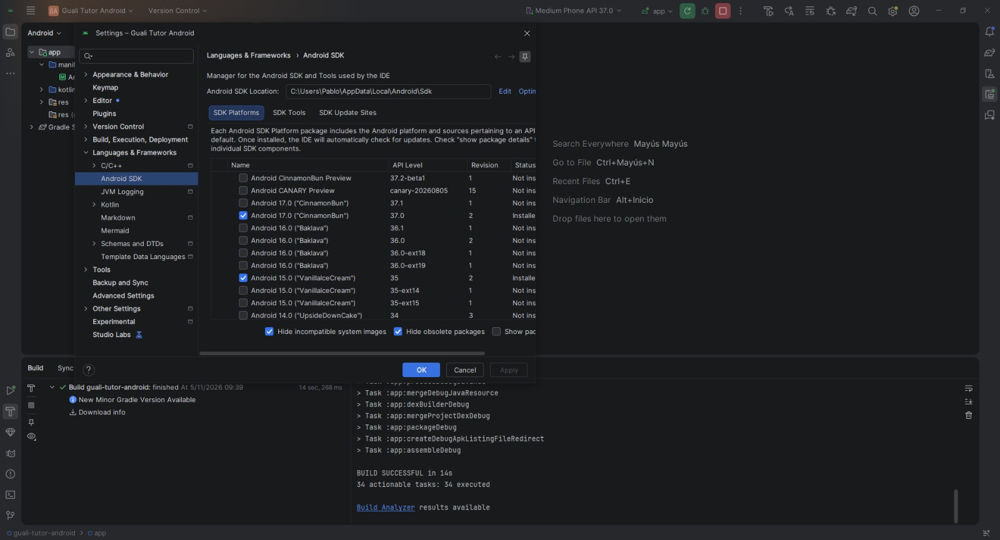


> En macOS y Linux el proceso es equivalente: se descarga el paquete correspondiente desde la misma página y se sigue el asistente.

## 4. Crear el emulador (dispositivo virtual)

1. En la pantalla de bienvenida (o dentro de un proyecto) abra el **Device Manager** (administrador de dispositivos).
2. Presione **Create Device** (crear dispositivo).
3. Elija un teléfono, por ejemplo **Pixel 6**, y presione **Next**.
4. Elija una imagen del sistema (por ejemplo la más reciente con el ícono de descarga). Si no está descargada, presione **Download** y espere. Luego presione **Next** y **Finish**.

> **Captura 03:** Dispositivo virtual creado en el Device Manager.

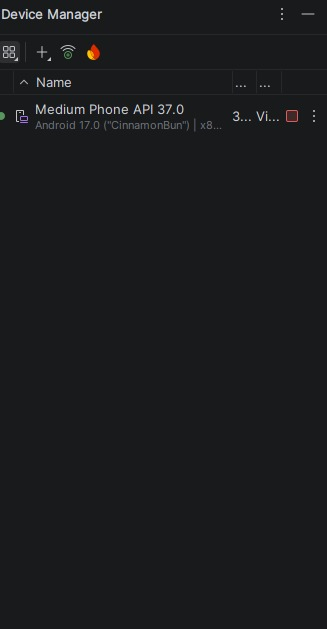

> Si se prefiere usar un celular real, active en el teléfono las **Opciones de desarrollador** y la **Depuración USB**, y conéctelo a la computadora con un cable.

## 5. Crear el proyecto

1. En la pantalla de bienvenida presione **New Project**.
2. En la lista de plantillas elija **Empty Views Activity** y presione **Next**.

> **Captura 04:** Selección de la plantilla Empty Views Activity.

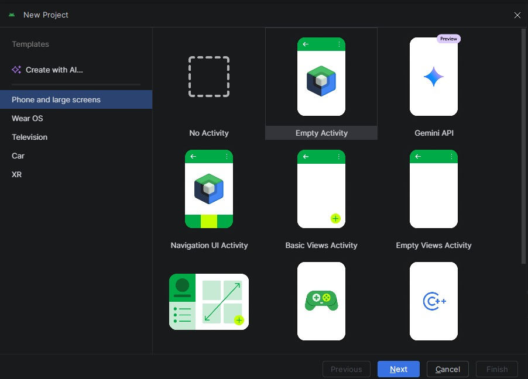

3. Complete los datos del proyecto:

| Campo | Valor |
| --- | --- |
| Name | `Guali Tutor` |
| Package name | `com.guali.tutor` |
| Save location | La carpeta donde se guardará el proyecto |
| Language | **Kotlin** |
| Minimum SDK | **API 24** |
| Build configuration language | **Kotlin DSL (build.gradle.kts)** |

> **Captura 05:** Datos del proyecto en el asistente.

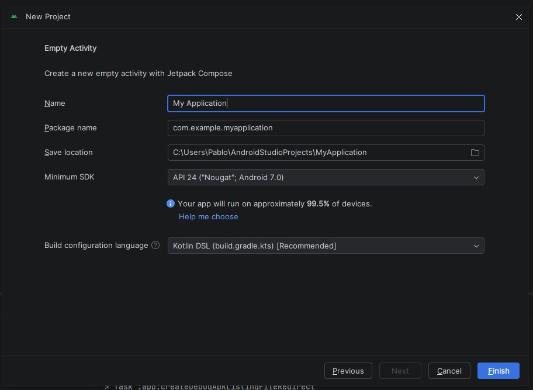

4. Presione **Finish** y espere a que Android Studio termine de preparar el proyecto (barra de progreso inferior). La primera vez puede tardar varios minutos porque descarga dependencias.
5. En el panel izquierdo cambie la vista a **Project** (o deje **Android**) y localice las carpetas principales:

| Ruta | Contenido |
| --- | --- |
| `app/src/main/java/com/guali/tutor/MainActivity.kt` | Código Kotlin de la pantalla |
| `app/src/main/res/layout/activity_main.xml` | Diseño de la pantalla |
| `app/src/main/res/values/` | Textos (`strings.xml`), colores (`colors.xml`) y tema (`themes.xml`) |
| `app/src/main/res/menu/` | Menús (se crea en el paso 7) |
| `app/src/main/res/drawable/` | Imágenes y formas (se crea en el paso 6.4) |

> **Captura 06:** Estructura inicial del proyecto en Android Studio.

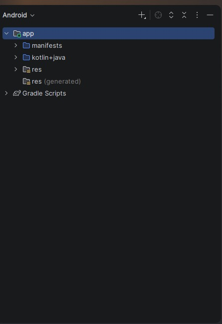

## 6. Textos, colores y tema

### 6.1 Textos (`strings.xml`)

Abra `app/src/main/res/values/strings.xml` y **reemplace todo su contenido** por:

```xml
<resources>
    <string name="app_name">Guali Tutor</string>
    <string name="leccion_activa">Lección Activa</string>
    <string name="sin_leccion">(ninguna)</string>
    <string name="panel_leccion_vacio">Abra una lección desde el menú Lección > Abrir Lección.</string>
    <string name="hint_editor">Escriba aquí su código Java</string>
    <string name="compilar">Compilar</string>
    <string name="ejecutar">Ejecutar</string>
    <string name="consola_inicial">Consola: aquí se mostrará la salida de la compilación y de la ejecución.</string>
    <string name="menu_leccion">Lección</string>
    <string name="abrir_leccion">Abrir Lección</string>
    <string name="cerrar_leccion">Cerrar Lección</string>
    <string name="menu_configuracion">Configuración</string>
    <string name="configurar_jdk">Configurar JDK</string>
    <string name="menu_bd">Base de Datos</string>
    <string name="importar_leccion">Importar Lección a BD</string>
    <string name="seleccionar_leccion_bd">Seleccionar Lección de BD</string>
    <string name="eliminar_leccion_bd">Eliminar Lección de BD</string>
    <string name="menu_historial">Historial</string>
    <string name="ver_historial">Ver Historial</string>
    <string name="menu_ayuda">Ayuda</string>
</resources>
```

> **Captura 07:** Archivo strings.xml con los textos de la aplicación.

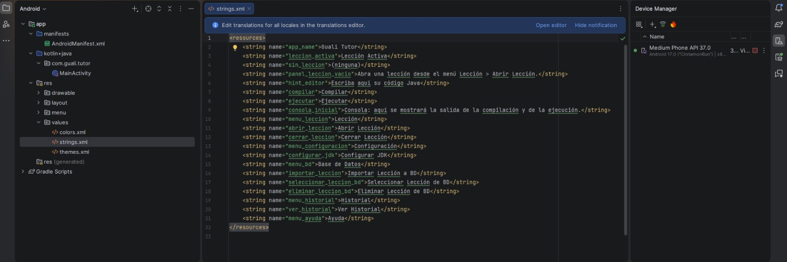

### 6.2 Colores (`colors.xml`)

Abra `app/src/main/res/values/colors.xml` y reemplace todo su contenido por:

```xml
<?xml version="1.0" encoding="utf-8"?>
<resources>
    <color name="negro">#FF000000</color>
    <color name="blanco">#FFFFFFFF</color>
    <color name="gris_borde">#FF9E9E9E</color>
    <color name="consola_fondo">#FF1E1E1E</color>
    <color name="consola_texto">#FFD4D4D4</color>
</resources>
```

### 6.3 Tema (`themes.xml`)

Abra `app/src/main/res/values/themes.xml` y reemplace todo su contenido por:

```xml
<resources>
    <style name="Theme.GualiTutor" parent="Theme.Material3.Light.NoActionBar" />
</resources>
```

El nombre del tema (`Theme.GualiTutor`) debe ser el mismo que usa el archivo `AndroidManifest.xml` en `android:theme`; el asistente lo crea con ese nombre cuando el proyecto se llama `Guali Tutor`. Este tema no tiene barra superior propia, porque la aplicación usa su propia barra de menú (paso 7). Si el proyecto tiene una carpeta `values-night`, con un archivo `themes.xml` dentro, **elimínela** (clic derecho > Delete). Así la aplicación siempre se ve con el tema claro.

> **Captura 08:** Archivo themes.xml con el tema de la aplicación.

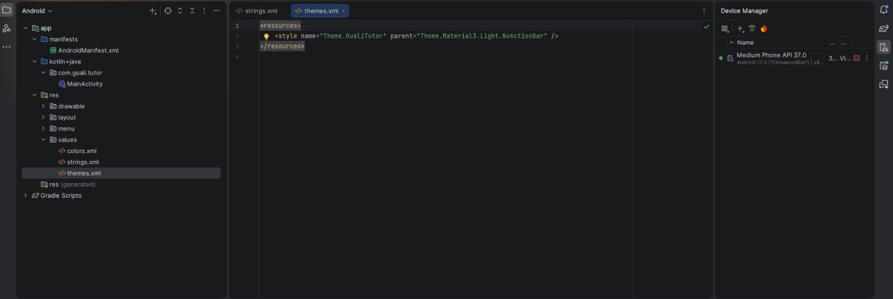

### 6.4 Borde de los paneles

Los paneles de lección y editor tienen un borde gris. Para crearlo:

1. Clic derecho en la carpeta `app/src/main/res/drawable`.
2. Elija **New > Drawable Resource File**.
3. En **File name** escriba `borde_panel` y presione **OK**.
4. Reemplace todo el contenido del archivo por:

```xml
<?xml version="1.0" encoding="utf-8"?>
<shape xmlns:android="http://schemas.android.com/apk/res/android"
    android:shape="rectangle">
    <solid android:color="@color/blanco" />
    <stroke
        android:width="1dp"
        android:color="@color/gris_borde" />
</shape>
```

## 7. Barra de menú

La barra de menú se define en un archivo XML y se muestra en el menú desplegable (los tres puntos) de la barra superior.

1. Clic derecho en la carpeta `app/src/main/res`.
2. Elija **New > Android Resource Directory**.
3. En **Resource type** elija **menu** y presione **OK**.
4. Clic derecho en la nueva carpeta `menu` > **New > Menu Resource File**.
5. En **File name** escriba `menu_principal` y presione **OK**.
6. Reemplace todo el contenido por:

```xml
<?xml version="1.0" encoding="utf-8"?>
<menu xmlns:android="http://schemas.android.com/apk/res/android"
    xmlns:app="http://schemas.android.com/apk/res-auto">

    <item
        android:id="@+id/menu_leccion"
        android:title="@string/menu_leccion"
        app:showAsAction="never">
        <menu>
            <item
                android:id="@+id/opcion_abrir_leccion"
                android:title="@string/abrir_leccion" />
            <item
                android:id="@+id/opcion_cerrar_leccion"
                android:title="@string/cerrar_leccion" />
        </menu>
    </item>

    <item
        android:id="@+id/menu_configuracion"
        android:title="@string/menu_configuracion"
        app:showAsAction="never">
        <menu>
            <item
                android:id="@+id/opcion_configurar_jdk"
                android:title="@string/configurar_jdk" />
        </menu>
    </item>

    <item
        android:id="@+id/menu_bd"
        android:title="@string/menu_bd"
        app:showAsAction="never">
        <menu>
            <item
                android:id="@+id/opcion_importar_leccion"
                android:title="@string/importar_leccion" />
            <item
                android:id="@+id/opcion_seleccionar_leccion_bd"
                android:title="@string/seleccionar_leccion_bd" />
            <item
                android:id="@+id/opcion_eliminar_leccion_bd"
                android:title="@string/eliminar_leccion_bd" />
        </menu>
    </item>

    <item
        android:id="@+id/menu_historial"
        android:title="@string/menu_historial"
        app:showAsAction="never">
        <menu>
            <item
                android:id="@+id/opcion_ver_historial"
                android:title="@string/ver_historial" />
        </menu>
    </item>

    <item
        android:id="@+id/opcion_ayuda"
        android:title="@string/menu_ayuda"
        app:showAsAction="never" />

</menu>
```

Cada `<item>` con otro `<menu>` adentro es un menú con submenú (por ejemplo, **Lección** tiene **Abrir Lección** y **Cerrar Lección**). El atributo `android:id` es el nombre con el que el código Kotlin identifica cada opción.

> **Captura 09:** Archivo menu_principal.xml con las opciones del menú.

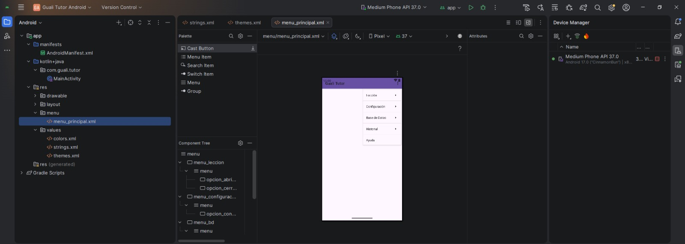

## 8. Pantalla principal (layout)

La pantalla se define en `app/src/main/res/layout/activity_main.xml`. Se construye por partes, de arriba hacia abajo. Cada parte se agrega **antes de la etiqueta de cierre** `</LinearLayout>`.

### 8.1 Contenedor y barra de menú

Abra `activity_main.xml`. Si está en la vista **Design**, cambie a la vista **Code** (botón en la esquina superior derecha). **Reemplace todo el contenido** por:

```xml
<?xml version="1.0" encoding="utf-8"?>
<LinearLayout xmlns:android="http://schemas.android.com/apk/res/android"
    xmlns:app="http://schemas.android.com/apk/res-auto"
    android:layout_width="match_parent"
    android:layout_height="match_parent"
    android:fitsSystemWindows="true"
    android:orientation="vertical">

    <com.google.android.material.appbar.MaterialToolbar
        android:id="@+id/barraMenu"
        android:layout_width="match_parent"
        android:layout_height="?attr/actionBarSize"
        app:title="@string/app_name" />

</LinearLayout>
```

- `LinearLayout` con `android:orientation="vertical"` coloca todos los elementos uno debajo del otro.
- `MaterialToolbar` es la barra superior. Su `id` es `barraMenu`.

> **Captura 10:** Vista Design con la barra de menú.

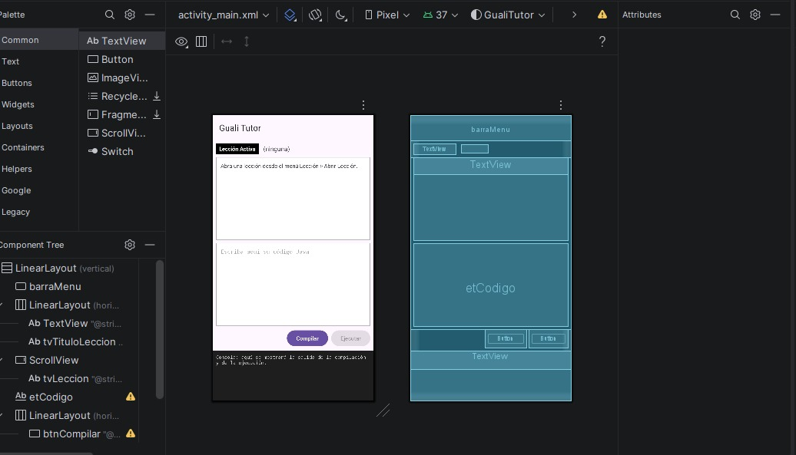

### 8.2 Título de lección activa

Agregue este bloque justo debajo de la barra y antes de `</LinearLayout>`:

```xml
    <LinearLayout
        android:layout_width="match_parent"
        android:layout_height="wrap_content"
        android:gravity="center_vertical"
        android:orientation="horizontal"
        android:padding="8dp">

        <TextView
            android:layout_width="wrap_content"
            android:layout_height="wrap_content"
            android:background="@color/negro"
            android:paddingHorizontal="8dp"
            android:paddingVertical="4dp"
            android:text="@string/leccion_activa"
            android:textColor="@color/blanco"
            android:textStyle="bold" />

        <TextView
            android:id="@+id/tvTituloLeccion"
            android:layout_width="wrap_content"
            android:layout_height="wrap_content"
            android:layout_marginStart="12dp"
            android:text="@string/sin_leccion"
            android:textSize="16sp" />
    </LinearLayout>
```

Tiene dos textos en una fila: la etiqueta **Lección Activa** (fondo negro) y el nombre de la lección (`tvTituloLeccion`).

### 8.3 Panel de lección activa

```xml
    <ScrollView
        android:layout_width="match_parent"
        android:layout_height="0dp"
        android:layout_marginHorizontal="8dp"
        android:layout_weight="1"
        android:background="@drawable/borde_panel">

        <TextView
            android:id="@+id/tvLeccion"
            android:layout_width="match_parent"
            android:layout_height="wrap_content"
            android:padding="12dp"
            android:text="@string/panel_leccion_vacio"
            android:textSize="14sp" />
    </ScrollView>
```

Es un `ScrollView`, que permite desplazar el texto si es largo. Con `android:layout_height="0dp"` y `android:layout_weight="1"` el panel ocupa el espacio disponible. Dentro está el texto `tvLeccion`.

### 8.4 Editor de código

```xml
    <EditText
        android:id="@+id/etCodigo"
        android:layout_width="match_parent"
        android:layout_height="0dp"
        android:layout_margin="8dp"
        android:layout_weight="1"
        android:background="@drawable/borde_panel"
        android:fontFamily="monospace"
        android:gravity="top|start"
        android:hint="@string/hint_editor"
        android:importantForAutofill="no"
        android:inputType="textMultiLine|textNoSuggestions"
        android:padding="12dp"
        android:textSize="14sp" />
```

`EditText` es un cuadro de texto editable. Se usa la fuente `monospace` y `inputType="textMultiLine"` para escribir varias líneas.

### 8.5 Botones Compilar y Ejecutar

```xml
    <LinearLayout
        android:layout_width="match_parent"
        android:layout_height="wrap_content"
        android:gravity="end"
        android:orientation="horizontal"
        android:paddingHorizontal="8dp"
        android:paddingBottom="8dp">

        <Button
            android:id="@+id/btnCompilar"
            android:layout_width="wrap_content"
            android:layout_height="wrap_content"
            android:layout_marginEnd="8dp"
            android:text="@string/compilar" />

        <Button
            android:id="@+id/btnEjecutar"
            android:layout_width="wrap_content"
            android:layout_height="wrap_content"
            android:enabled="false"
            android:text="@string/ejecutar" />
    </LinearLayout>
```

El botón **Ejecutar** empieza deshabilitado (`android:enabled="false"`).

### 8.6 Panel de consola

```xml
    <ScrollView
        android:id="@+id/svConsola"
        android:layout_width="match_parent"
        android:layout_height="0dp"
        android:layout_weight="0.6"
        android:background="@color/consola_fondo">

        <TextView
            android:id="@+id/tvConsola"
            android:layout_width="match_parent"
            android:layout_height="wrap_content"
            android:fontFamily="monospace"
            android:padding="8dp"
            android:text="@string/consola_inicial"
            android:textColor="@color/consola_texto"
            android:textSize="12sp" />
    </ScrollView>
```

Es un `ScrollView` con fondo oscuro y texto claro. Los mensajes se escribirán en `tvConsola`.

> **Captura 11:** Vista Design con todos los elementos de la pantalla.


## 9. Código Kotlin de la pantalla

Abra `app/src/main/java/com/guali/tutor/MainActivity.kt` y **reemplace todo su contenido** por:

```kotlin
package com.guali.tutor

import android.os.Bundle
import androidx.appcompat.app.AppCompatActivity
import com.google.android.material.appbar.MaterialToolbar

class MainActivity : AppCompatActivity() {

    override fun onCreate(savedInstanceState: Bundle?) {
        super.onCreate(savedInstanceState)
        setContentView(R.layout.activity_main)

        val barraMenu = findViewById<MaterialToolbar>(R.id.barraMenu)
        barraMenu.inflateMenu(R.menu.menu_principal)
    }
}
```

Este código solo hace dos cosas:

| Línea | Qué hace |
| --- | --- |
| `setContentView(R.layout.activity_main)` | Muestra en pantalla el diseño creado en el paso 8 |
| `barraMenu.inflateMenu(R.menu.menu_principal)` | Coloca en la barra superior las opciones del archivo `menu_principal.xml` (paso 7) |

Los botones **Compilar** y **Ejecutar** y las opciones del menú todavía no tienen código, por eso al presionarlos no pasa nada. Esa parte es el funcionamiento, que no forma parte de este front end.

> **Captura 12:** Archivo MainActivity.kt con el código de la pantalla.

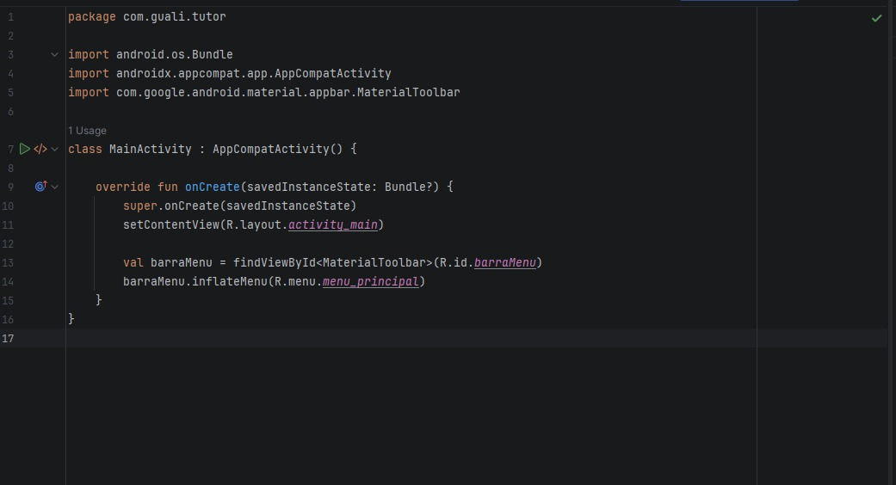

## 10. Ejecutar la aplicación

1. En la barra superior de Android Studio elija el dispositivo (el emulador creado en el paso 4).
2. Presione el botón verde **Run** (▶). La primera vez, el emulador tarda en iniciar.
3. Cuando termine, la aplicación se muestra en el emulador.

> **Captura 13:** Pantalla principal de Guali Tutor en el emulador.

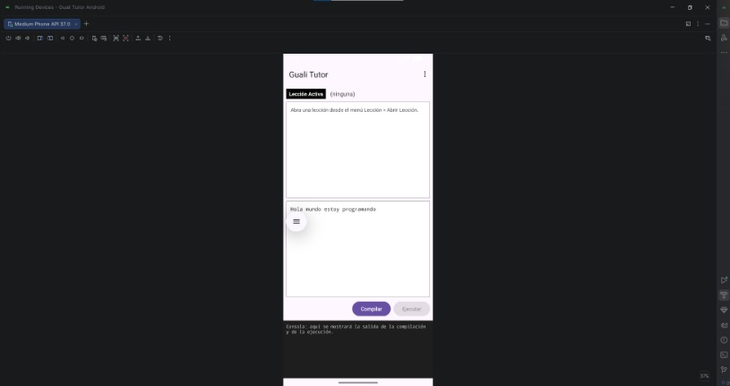

4. Presione los tres puntos de la barra superior para ver el menú.

> **Captura 14:** Menú desplegado con Lección, Configuración, Base de Datos, Historial y Ayuda.

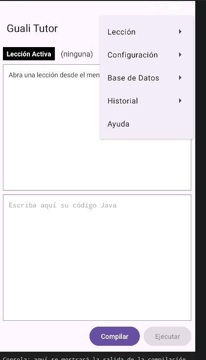

5. Revise que estén todos los elementos: barra de menú, título de lección activa, panel de lección, editor de código, botones **Compilar** y **Ejecutar** y panel de consola.

> Al presionar los botones o las opciones del menú no ocurre ninguna acción, porque esta versión es únicamente la parte visual.

## 11. Problemas comunes

| Problema | Solución |
| --- | --- |
| Líneas en rojo en el código o `Unresolved reference: R` | Presione **File > Sync Project with Gradle Files** y luego **Build > Rebuild Project** |
| `Unresolved reference` o `Cannot resolve symbol` en el menú o el layout | Revise que el archivo `strings.xml` y `colors.xml` se reemplazaron completos (pasos 6.1 y 6.2) |
| El texto aparece casi invisible o el fondo es oscuro | Elimine la carpeta `values-night` (paso 6.3) |
| El emulador no inicia o va muy lento | Cierre otros programas y revise que la virtualización esté activada en la BIOS; use una imagen del sistema más ligera |
| `SDK location not found` al sincronizar | Configure el SDK como en el paso 3.1. Si sigue el error, cree en la carpeta raíz del proyecto un archivo `local.properties` con la línea `sdk.dir=C\:\\Users\\SuUsuario\\AppData\\Local\\Android\\Sdk` (con la ruta de su SDK) y sincronice otra vez |
| La descarga de Gradle falla | Revise la conexión a internet y vuelva a presionar **Sync Project with Gradle Files** |
| La barra queda debajo de la barra de estado del teléfono | Revise que el `LinearLayout` principal tenga `android:fitsSystemWindows="true"` |

## 12. Estructura final del proyecto

```
Guali Tutor/
└── app/
    └── src/
        └── main/
            ├── AndroidManifest.xml
            ├── java/com/guali/tutor/
            │   └── MainActivity.kt
            └── res/
                ├── drawable/
                │   └── borde_panel.xml
                ├── layout/
                │   └── activity_main.xml
                ├── menu/
                │   └── menu_principal.xml
                └── values/
                    ├── colors.xml
                    ├── strings.xml
                    └── themes.xml
```

El código fuente completo está en el proyecto de Android Studio que acompaña a este tutorial (carpeta `guali-tutor-android`).
